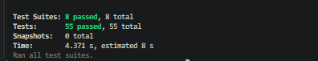

# Informe de Testing Automatizado - App Mingo
**Materia / Proyecto:** Aplicación Móvil "Mingo" (Gestión de Almacén y Ventas)  
**Alumno / Desarrollador:** Juan Castro, Gian Franco Ferreyra  
**Tecnologías:** React Native, Expo, Jest, React Native Testing Library  

---

## 1. ¿De qué se trata este trabajo?

Para la aplicación móvil **Mingo** (que creamos para gestionar las ventas, el stock y la libreta de fiados de un almacén), implementamos una suite de **pruebas automatizadas**.

El objetivo principal es asegurarnos de que las partes más delicadas del negocio no fallen:
1. **Cobro en Efectivo:** Que el cálculo del vuelto sea exacto, que si el cliente no ingresa dinero el sistema asuma automáticamente que "paga justo" (monto exacto), y que si ingresa menos dinero del total le avise con una alerta.
2. **Libreta de Fiados (Cuentas Corrientes):** Que cuando se anote una compra fiada la deuda del cliente aumente, y cuando el cliente venga a pagar la deuda se descuente correctamente.
3. **Control de Stock y Ventas:** Que cada vez que se confirme una venta, las unidades salgan del inventario automáticamente.
4. **Pantallas y Componentes clave:** Que el Login valide contraseñas cortas o campos vacíos, y que el botón de volver funcione bien en Android y iPhone.

---

## 2. Evidencia de Ejecución (Resultados Reales)

Las pruebas fueron ejecutadas con **Jest** y pasaron todas con éxito (55 pruebas pasadas de 55 en total).

### Captura de pantalla de la terminal



### Salida de la consola (`npm test`)

```text
 PASS  __tests__/utils/sanitizers.test.ts
 PASS  __tests__/services/saleService.test.ts
 PASS  __tests__/services/fiadoService.test.ts
 PASS  __tests__/components/CobroEfectivo.test.tsx
 PASS  __tests__/screens/S01_LoginScreen.test.tsx
 PASS  __tests__/components/HeaderBackButton.test.tsx
 PASS  __tests__/screens/S08_FiadosScreen.test.tsx
 PASS  __tests__/screens/S09_VentasScreen.test.tsx

Test Suites: 8 passed, 8 total
Tests:       55 passed, 55 total
Snapshots:   0 total
Time:        4.371 s
Ran all test suites.
```

---

## 3. ¿Cómo está armada la carpeta de pruebas?

Organizamos los tests dentro de la carpeta `__tests__` para separar la lógica de las pantallas y los servicios:

```text
proyect_appMobile/
├── __tests__/
│   ├── components/
│   │   ├── CobroEfectivo.test.tsx      -> Prueba el cálculo de vuelto, botón de pago exacto y validaciones
│   │   └── HeaderBackButton.test.tsx  -> Prueba el botón de volver atrás y los iconos según celular
│   ├── screens/
│   │   ├── S01_LoginScreen.test.tsx   -> Prueba validaciones de correo, contraseña y login
│   │   ├── S08_FiadosScreen.test.tsx  -> Prueba el buscador de clientes, alta y borrado con deuda
│   │   └── S09_VentasScreen.test.tsx  -> Prueba el changuito de compras y el modal de cobro
│   ├── services/
│   │   ├── fiadoService.test.ts       -> Prueba sumar/restar deuda y crear clientes en la base de datos
│   │   └── saleService.test.ts        -> Prueba que al vender se descuente el stock
│   └── utils/
│       └── sanitizers.test.ts         -> Prueba que entienda precios con comas (ej: 150,50) y no rompa
├── jest.config.js                     -> Archivo de configuración para Jest con Expo
├── jest.setup.ts                      -> Mocks de Firebase, navegación y alertas
└── package.json                       -> Comandos para correr los tests
```

---

## 4. Resumen de los Casos de Prueba Implementados

En total se diseñaron **55 casos de prueba**. Los más importantes son:

| Módulo | ¿Qué probamos? | Entrada / Acción | Resultado que esperamos |
| :--- | :--- | :--- | :--- |
| **Cobro Efectivo** | Autocompletado si no pone plata ("paga justo") | Campo vacío `""` y click en "Confirmar" | Asume el monto exacto, vuelto en \$0 y aprueba la venta. |
| **Cobro Efectivo** | Botón rápido "Paga Justo" | Click en botón "Paga Justo" | Llena el casillero con el total exacto. |
| **Cobro Efectivo** | Dinero insuficiente | Compra de \$3500, pone \$2000 | Tira alerta avisando que faltan \$1500 y frena el cobro. |
| **Cobro Efectivo** | Cálculo de vuelto correcto | Compra de \$3500, paga con \$5000 | Muestra en pantalla `Vuelto a entregar: $1500.00`. |
| **Cobro Efectivo** | Números con coma decimal argentina | Ingresa `"2000,50"` | Convierte la coma a punto y calcula el vuelto sin error. |
| **Fiados** | Alta de cliente fiado | Nombre: "Don Carlos", Deuda: \$0 | Crea el cliente en Firebase con deuda inicial en \$0. |
| **Fiados** | Compra fiada (+ deuda) | Cliente debe \$0, fía \$4500 | Le suma los \$4500 a la deuda del cliente en la base de datos. |
| **Fiados** | Entrega / Pago (- deuda) | Cliente debe \$4500, entrega \$2000 | Le descuenta \$2000, dejando la deuda en \$2500. |
| **Fiados** | Alerta al borrar cliente con deuda | Borrar cliente que debe plata | Pregunta primero antes de borrar si tiene saldo pendiente. |
| **Ventas / Stock** | Descuento automático de stock | Venta de 2 leches y 1 pan | Descuenta 2 unidades de leche y 1 de pan en el stock. |
| **Login** | Validación de campos vacíos | Click en "Iniciar Sesión" sin datos | Muestra alerta pidiendo correo y contraseña. |
| **Login** | Contraseña corta en registro | Pone contraseña de 5 letras | Muestra alerta de que requiere al menos 6 caracteres. |
| **Navegación** | Botón volver en iPhone vs Android | Simulamos iOS y Android | Muestra `chevron-back` en iOS y `arrow-back` en Android. |

---

## 5. ¿Cómo correr las pruebas? (Guía de comandos)

Cualquiera que baje este proyecto puede correr los tests con estos pasos:

### 1. Instalar dependencias necesarias:
```bash
npm install --save-dev jest jest-expo @react-native/jest-preset @testing-library/react-native @testing-library/jest-native @types/jest react-test-renderer@19.3.0 --legacy-peer-deps
```

### 2. Correr todas las pruebas:
```bash
npm test
```

### 3. Correr las pruebas mientras programamos (Modo Watch):
```bash
npm run test:watch
```

### 4. Ver el porcentaje de cobertura de código (Coverage):
```bash
npm run test:coverage
```
Este comando nos genera una carpeta llamada `coverage`. Si abrimos el archivo `coverage/lcov-report/index.html` en el navegador, podemos ver en verde exactamente qué líneas de código fueron probadas.

---

## 6. ¿Por qué usamos "Mocks" en las pruebas?

Un problema común al probar aplicaciones en React Native es que dependen de cosas externas:
- **Firebase:** Si no tuviéramos mocks, cada test necesitaría internet y crearía clientes y ventas reales en la base de datos de producción.
- **Navegación:** No tenemos un celular físico conectado para apretar botones reales.

Por eso, en `jest.setup.ts` creamos **"Mocks"** (simuladores):
- Simulamos que Firebase siempre contesta rápido y en memoria.
- Simulamos `Alert.alert` para verificar que los mensajes de error aparezcan sin frenar el test.
- De esta manera las 55 pruebas corren en **menos de 5 segundos** en cualquier computadora.
